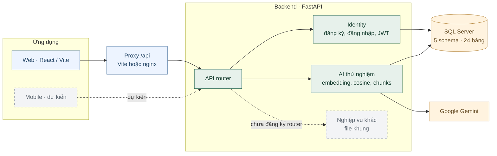

# FamilyConnect

**FamilyConnect** là đồ án môn **Hệ quản trị cơ sở dữ liệu**: nền tảng cộng đồng gia đình số để quản lý gia phả, kết nối thành viên, tổ chức sự kiện và lưu giữ di sản qua nhiều thế hệ.

Dự án lấy **SQL Server và T-SQL** làm trọng tâm (ràng buộc, chỉ mục, View, Function, Stored Procedure, Transaction, Trigger, phân quyền), kèm ứng dụng web để minh họa nghiệp vụ.

**24 bảng · 5 schema · 27 khóa ngoại**

## Yêu cầu nghiệp vụ

| Không gian          | Mục tiêu nghiệp vụ                                                          |
| ------------------- | --------------------------------------------------------------------------- |
| Gia phả và danh bạ  | Quản lý thành viên, chi nhánh, quan hệ huyết thống, học vấn và công việc.   |
| Cộng đồng           | Chia sẻ bài viết, hình ảnh, bình luận và cảm xúc.                           |
| Sự kiện             | Tổ chức hoạt động, phản hồi tham dự, nhắc lịch và lưu ảnh.                  |
| Di sản và vinh danh | Lưu giữ tài liệu, câu chuyện, hình ảnh và ghi nhận đóng góp.                |
| Quản trị            | Xác minh thành viên, phân quyền, kiểm duyệt và theo dõi hoạt động.          |
| Trợ lý AI           | Tra cứu ngữ nghĩa, hỏi đáp và giải thích quan hệ dựa trên dữ liệu gia đình. |

### Vai trò người dùng

| Vai trò       | Quyền nghiệp vụ dự kiến                                                                        |
| ------------- | ---------------------------------------------------------------------------------------------- |
| `admin`       | Quản lý tài khoản, phân quyền, kiểm duyệt, cấu hình và xem nhật ký.                            |
| `family_head` | Quản lý gia đình/chi nhánh được giao, xét duyệt xác minh, cập nhật gia phả và tổ chức sự kiện. |
| `member`      | Cập nhật hồ sơ cá nhân, xin xác minh, tham gia cộng đồng và đóng góp di sản.                   |
| `guest`       | Xem nội dung công khai (phạm vi còn cần thống nhất).                                           |

Tài khoản đăng ký mới có vai trò `member`.

### Quy tắc chính

- Một tài khoản liên kết tối đa một hồ sơ gia phả; hồ sơ có thể chưa gắn tài khoản.
- Quan hệ cha mẹ – con không được tự thân hoặc trùng cặp. Kiểm tra chu trình và giới hạn hai cha mẹ chưa được triển khai.
- Cặp hôn nhân lưu theo thứ tự so sánh chuỗi UUID; kiểm tra cận huyết là phần dự kiến.
- Học vấn và công việc lưu riêng trong `Educations` và `WorkHistories`.
- Tư liệu gồm `document`, `story`, `photo`, mỗi loại có yêu cầu nội dung tương ứng.
- Mật khẩu được băm; quyền ứng dụng và phạm vi dữ liệu gia đình được kiểm tra ở backend khi hoàn thiện endpoint.

## Công nghệ

| Thành phần        | Công nghệ                                                                          |
| ----------------- | ---------------------------------------------------------------------------------- |
| Frontend          | React 18, Vite, Tailwind CSS, React Router, Axios, TanStack Query, React Hook Form |
| Backend           | FastAPI, SQLAlchemy, mssql-python, JWT, Argon2                                     |
| Database          | Microsoft SQL Server 2025, T-SQL                                                   |
| AI thử nghiệm     | Google Gemini SDK                                                                  |
| Môi trường Docker | Docker Compose, nginx                                                              |

## Kiến trúc hệ thống



Nét liền là luồng đã có mã xử lý; nét đứt là phần dự kiến. Hiện API chính chỉ đăng ký domain `identity` và `ai_assistant`; các domain nghiệp vụ khác, mobile và worker còn là khung.

## ERD — 24 bảng

| Schema      | Số bảng | Nội dung                                              |
| ----------- | ------: | ----------------------------------------------------- |
| `core`      |       5 | Tài khoản, gia đình, chi nhánh, xác minh và cấu hình. |
| `genealogy` |       5 | Hồ sơ thành viên và quan hệ gia phả.                  |
| `community` |       9 | Bài viết, tương tác, sự kiện và báo cáo nội dung.     |
| `heritage`  |       3 | Tư liệu, vinh danh và kho đoạn kiến thức.             |
| `reports`   |       2 | Nhật ký hoạt động và lịch sử hỏi đáp AI.              |

Ký hiệu: PK khóa chính, FK khóa ngoại, UK giá trị duy nhất. Nét đứt là quan hệ non-identifying. Chỉ các khóa ngoại đã khai báo trong SQL mới được vẽ.

```mermaid
erDiagram
    direction LR
    CORE_USERS {
        uniqueidentifier UserId PK
        nvarchar Email UK
        nvarchar PasswordHash
        nvarchar FullName
        nvarchar Role
        bit IsActive
        datetime2 CreatedAt
    }
    CORE_FAMILIES {
        uniqueidentifier Id PK
        nvarchar Name
        datetime2 CreatedAt
    }
    CORE_BRANCHES {
        uniqueidentifier Id PK
        uniqueidentifier FamilyId FK
        nvarchar Name
        datetime2 CreatedAt
    }
    CORE_MEMBER_VERIFICATIONS {
        uniqueidentifier Id PK
        uniqueidentifier UserId FK
        uniqueidentifier MemberId FK
        nvarchar Status
        datetime2 CreatedAt
    }
    GENEALOGY_MEMBERS {
        uniqueidentifier Id PK
        uniqueidentifier FamilyId FK
        uniqueidentifier BranchId FK "nullable"
        uniqueidentifier UserId FK "nullable, unique"
        nvarchar FullName
        date BirthDate "nullable"
        nvarchar Location "nullable"
        datetime2 CreatedAt
    }
    GENEALOGY_PARENT_CHILD {
        uniqueidentifier Id PK
        uniqueidentifier ParentId FK
        uniqueidentifier ChildId FK
        datetime2 CreatedAt
    }
    GENEALOGY_MARRIAGES {
        uniqueidentifier Id PK
        uniqueidentifier Spouse1Id FK
        uniqueidentifier Spouse2Id FK
        date MarriedDate "nullable"
        datetime2 CreatedAt
    }
    GENEALOGY_EDUCATIONS {
        uniqueidentifier Id PK
        uniqueidentifier MemberId FK
        nvarchar Institution
        nvarchar Degree
        date StartDate
        date EndDate
        datetime2 CreatedAt
    }
    GENEALOGY_WORK_HISTORIES {
        uniqueidentifier Id PK
        uniqueidentifier MemberId FK
        nvarchar Company
        nvarchar Position
        date StartDate
        date EndDate
        datetime2 CreatedAt
    }
    COMMUNITY_POSTS {
        uniqueidentifier Id PK
        uniqueidentifier UserId
        uniqueidentifier FamilyId
        nvarchar Content
        datetime2 CreatedAt
    }
    COMMUNITY_POST_MEDIA {
        uniqueidentifier Id PK
        uniqueidentifier PostId FK
        nvarchar MediaUrl
        nvarchar MediaType
        datetime2 CreatedAt
    }
    COMMUNITY_COMMENTS {
        uniqueidentifier Id PK
        uniqueidentifier PostId FK
        uniqueidentifier UserId
        nvarchar Content
        datetime2 CreatedAt
    }
    COMMUNITY_REACTIONS {
        uniqueidentifier Id PK
        uniqueidentifier PostId FK
        uniqueidentifier UserId
        nvarchar Type
        datetime2 CreatedAt
    }
    COMMUNITY_EVENTS {
        uniqueidentifier Id PK
        uniqueidentifier FamilyId
        nvarchar Title
        datetime2 EventDate
        nvarchar Location
        datetime2 CreatedAt
    }
    COMMUNITY_EVENT_PARTICIPANTS {
        uniqueidentifier Id PK
        uniqueidentifier EventId FK
        uniqueidentifier MemberId
        nvarchar RsvpStatus
        datetime2 CreatedAt
    }
    COMMUNITY_EVENT_REMINDERS {
        uniqueidentifier Id PK
        uniqueidentifier EventId FK
        datetime2 ReminderTime
        nvarchar Status
        datetime2 CreatedAt
    }
    COMMUNITY_EVENT_GALLERIES {
        uniqueidentifier Id PK
        uniqueidentifier EventId FK
        nvarchar MediaUrl
        uniqueidentifier UploadedBy FK
        datetime2 CreatedAt
    }
    COMMUNITY_REPORTED_CONTENTS {
        uniqueidentifier Id PK
        uniqueidentifier TargetId
        nvarchar TargetType
        uniqueidentifier ReportedBy FK
        nvarchar Reason
        nvarchar Status
        datetime2 CreatedAt
    }
    CORE_SYSTEM_CONFIGS {
        varchar ConfigKey PK
        nvarchar_max ConfigValue
        nvarchar Description
        datetime2 UpdatedAt
    }
    HERITAGE_HONORS {
        uniqueidentifier Id PK
        uniqueidentifier MemberId FK
        nvarchar Title
        nvarchar Description
        date DateAwarded
        datetime2 CreatedAt
    }
    REPORTS_AUDIT_LOG {
        uniqueidentifier Id PK
        uniqueidentifier UserId FK "nullable"
        nvarchar Action
        datetime2 CreatedAt
    }
    HERITAGE_ITEMS {
        uniqueidentifier Id PK
        uniqueidentifier FamilyId FK
        uniqueidentifier CreatedByUserId FK
        nvarchar Type
        nvarchar Title
        nvarchar Description "nullable"
        nvarchar Content "nullable"
        nvarchar MediaUrl "nullable"
        datetime2 CreatedAt
    }
    HERITAGE_KNOWLEDGE_CHUNKS {
        uniqueidentifier Id PK
        uniqueidentifier FamilyId FK
        nvarchar SourceType
        uniqueidentifier SourceId
        int ChunkIndex
        nvarchar ChunkText
        nvarchar SummaryText "nullable"
        nvarchar_max EmbeddingJson "nullable"
        nvarchar SyncStatus
        datetime2 UpdatedAt
        datetime2 CreatedAt
    }
    REPORTS_AI_CHAT_MESSAGES {
        uniqueidentifier Id PK
        uniqueidentifier FamilyId FK
        uniqueidentifier UserId FK
        nvarchar QueryType
        nvarchar Question
        nvarchar_max Answer
        nvarchar_max ReferencedSourceIds "nullable"
        datetime2 CreatedAt
    }

    CORE_FAMILIES ||..o{ CORE_BRANCHES : has
    CORE_FAMILIES ||..o{ GENEALOGY_MEMBERS : contains
    CORE_BRANCHES o|..o{ GENEALOGY_MEMBERS : groups
    CORE_USERS o|..o| GENEALOGY_MEMBERS : linked_account
    CORE_USERS ||..o{ CORE_MEMBER_VERIFICATIONS : requests
    GENEALOGY_MEMBERS ||..o{ CORE_MEMBER_VERIFICATIONS : verified_member
    GENEALOGY_MEMBERS ||..o{ GENEALOGY_PARENT_CHILD : parent
    GENEALOGY_MEMBERS ||..o{ GENEALOGY_PARENT_CHILD : child
    GENEALOGY_MEMBERS ||..o{ GENEALOGY_MARRIAGES : spouse1
    GENEALOGY_MEMBERS ||..o{ GENEALOGY_MARRIAGES : spouse2
    GENEALOGY_MEMBERS ||..o{ GENEALOGY_EDUCATIONS : studied
    GENEALOGY_MEMBERS ||..o{ GENEALOGY_WORK_HISTORIES : worked

    COMMUNITY_POSTS ||..o{ COMMUNITY_POST_MEDIA : attaches
    COMMUNITY_POSTS ||..o{ COMMUNITY_COMMENTS : has
    COMMUNITY_POSTS ||..o{ COMMUNITY_REACTIONS : receives

    COMMUNITY_EVENTS ||..o{ COMMUNITY_EVENT_PARTICIPANTS : has
    COMMUNITY_EVENTS ||..o{ COMMUNITY_EVENT_REMINDERS : schedules
    COMMUNITY_EVENTS ||..o{ COMMUNITY_EVENT_GALLERIES : contains
    CORE_USERS ||..o{ COMMUNITY_EVENT_GALLERIES : uploads
    CORE_USERS ||..o{ COMMUNITY_REPORTED_CONTENTS : reports
    GENEALOGY_MEMBERS ||..o{ HERITAGE_HONORS : receives

    CORE_USERS o|..o{ REPORTS_AUDIT_LOG : performs
    CORE_FAMILIES ||..o{ HERITAGE_ITEMS : preserves
    CORE_USERS ||..o{ HERITAGE_ITEMS : contributes
    CORE_FAMILIES ||..o{ HERITAGE_KNOWLEDGE_CHUNKS : stores
    CORE_FAMILIES ||..o{ REPORTS_AI_CHAT_MESSAGES : contains
    CORE_USERS ||..o{ REPORTS_AI_CHAT_MESSAGES : asks
```

<details>
<summary><strong>Mở ERD đầy đủ: 24 bảng · 5 schema · 27 khóa ngoại</strong></summary>



</details>

### Các liên kết chưa có khóa ngoại

| Cột                                          | Bản ghi liên quan theo nghiệp vụ                   |
| -------------------------------------------- | -------------------------------------------------- |
| `community.Posts.UserId`                     | `core.Users.UserId`                                |
| `community.Posts.FamilyId`                   | `core.Families.Id`                                 |
| `community.Comments.UserId`                  | `core.Users.UserId`                                |
| `community.Reactions.UserId`                 | `core.Users.UserId`                                |
| `community.Events.FamilyId`                  | `core.Families.Id`                                 |
| `community.EventParticipants.MemberId`       | `genealogy.Members.Id`                             |
| `community.ReportedContents.TargetId`        | Theo `TargetType`; nguồn photo còn cần thống nhất. |
| `heritage.KnowledgeChunks.SourceId`          | Posts, Items hoặc Members theo `SourceType`.       |
| `reports.AiChatMessages.ReferencedSourceIds` | Danh sách nguồn dưới dạng JSON.                    |

Các liên kết này chưa được bảo đảm toàn vẹn bằng FK. Bảng `MemberClosure`, bảng thông báo và cơ chế tự ghi lịch sử hỏi đáp chưa được triển khai. Embedding hiện lưu dạng JSON, chưa dùng kiểu `VECTOR` native.

## API hiện có

API chạy tại http://localhost:8000, Swagger tại http://localhost:8000/docs.

| Method | Đường dẫn                | Thành công | Phụ thuộc và xác thực                 |
| ------ | ------------------------ | ---------: | ------------------------------------- |
| GET    | `/health`                |        200 | Không JWT, không truy vấn database.   |
| POST   | `/api/auth/register`     |        201 | Database; không yêu cầu JWT.          |
| POST   | `/api/auth/login`        |        200 | Database; không yêu cầu JWT.          |
| GET    | `/api/auth/me`           |        200 | Bearer JWT, tài khoản đang hoạt động. |
| POST   | `/api/ai/test-embedding` |        200 | Gemini API key.                       |
| POST   | `/api/ai/test-cosine`    |        200 | Gemini, database và Function cosine.  |
| POST   | `/api/ai/chunks`         |        201 | Gemini, database và SP upsert.        |

Các API AI là bản thử nghiệm, chưa kiểm tra JWT hoặc quyền gia đình. API gia phả, cộng đồng, sự kiện, di sản, xác minh và quản trị chưa được đăng ký vào router chính.

### Xác thực

Đăng ký:

```http
POST /api/auth/register
Content-Type: application/json
```

```json
{
  "full_name": "Nguyễn Minh An",
  "email": "an@example.com",
  "password": "ExampleOnly!2026"
}
```

Họ tên 2–200 ký tự, email hợp lệ, mật khẩu 8–128 ký tự. Response 201 và response đăng nhập (200) cùng trả `access_token`, `token_type` và thông tin `user`.

Lấy tài khoản hiện tại:

```http
GET /api/auth/me
Authorization: Bearer <jwt_access_token>
```

JWT dùng HS256, mặc định 60 phút. Chưa có refresh token hoặc endpoint thu hồi token.

### AI thử nghiệm

| Endpoint                 | Request chính                                                                                   | Response chính                                             |
| ------------------------ | ----------------------------------------------------------------------------------------------- | ---------------------------------------------------------- |
| `/api/ai/test-embedding` | `text` (1–2000 ký tự)                                                                           | `model`, `dimensions`, `preview_first_5`, `embedding_json` |
| `/api/ai/test-cosine`    | `text_a`, `text_b` (mỗi trường 1–2000 ký tự)                                                    | `text_a`, `text_b`, `dimensions`, `cosine_similarity`      |
| `/api/ai/chunks`         | `family_id`, `source_type`, `source_id`, `chunk_index`, `chunk_text`, `summary_text` (tùy chọn) | `chunk_id`, `action_taken`, `dimensions`                   |

Mặc định dùng `gemini-embedding-001`, 256 chiều. Endpoint `chunks` gọi `heritage.usp_UpsertKnowledgeChunk`; `action_taken` là `INSERT` hoặc `UPDATE`, cả hai đều trả 201. `source_type` nhận `post`, `heritage`, `member`; `source_id` chưa được kiểm tra bản ghi nguồn hay quyền truy cập.

### Mã lỗi

| HTTP | Trường hợp                                                     |
| ---- | -------------------------------------------------------------- |
| 401  | Sai thông tin đăng nhập, tài khoản khóa hoặc JWT không hợp lệ. |
| 409  | Email đăng ký đã tồn tại.                                      |
| 422  | Request không hợp lệ theo DTO.                                 |
| 502  | Gọi Gemini lỗi hoặc không nhận được embedding.                 |
| 503  | Gemini API key thiếu hoặc vẫn là giá trị mẫu.                  |

## Hiện trạng phát triển

- **Đã có:** script tạo database và dữ liệu mẫu; phân quyền CSDL; API đăng ký, đăng nhập, lấy tài khoản hiện tại; giao diện xác thực và dashboard cơ bản.
- **AI thử nghiệm:** tạo embedding bằng Gemini, tính cosine bằng T-SQL, lưu/cập nhật đoạn kiến thức kèm vector JSON.
- **Đang phát triển:** API/giao diện gia phả, cộng đồng, sự kiện, di sản, xác minh, quản trị và chatbot hoàn chỉnh. Mobile, worker và các file Trigger còn là khung.
- **Kiểm thử:** có kịch bản SQL AI thủ công và hướng dẫn kiểm tra quyền; chưa có test API, E2E và hiệu năng.
