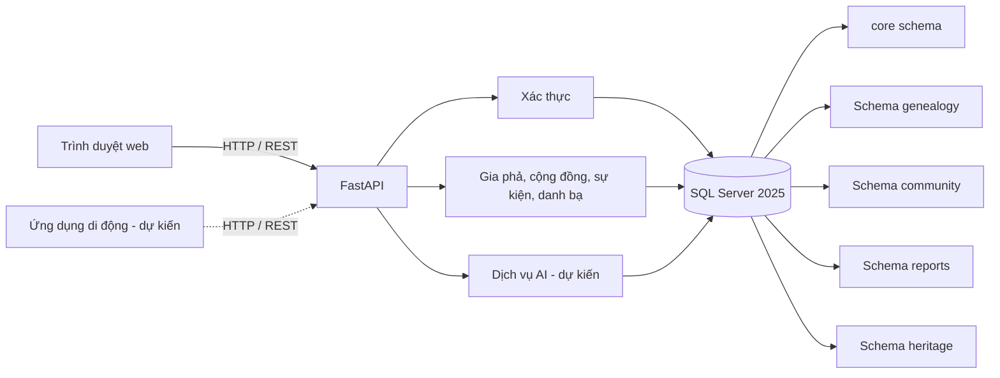

# Kiến trúc hệ thống

- Giao diện React/Vite gọi API FastAPI qua đường dẫn `/api`.
- Backend kết nối SQL Server bằng các biến cấu hình `MSSQL_HOST`, `MSSQL_PORT`, `MSSQL_DB`, `MSSQL_USER`, `MSSQL_SA_PASSWORD`.
- Sơ đồ dữ liệu và các bảng hiện có nằm ở [ERD](../erd/README.md); T-SQL được tổ chức theo schema trong database/schema/.
- Trong bản hiện tại, nhóm đã có đăng ký, đăng nhập và xem tài khoản bằng JWT. Các chức năng nghiệp vụ khác vẫn đang được phát triển.
