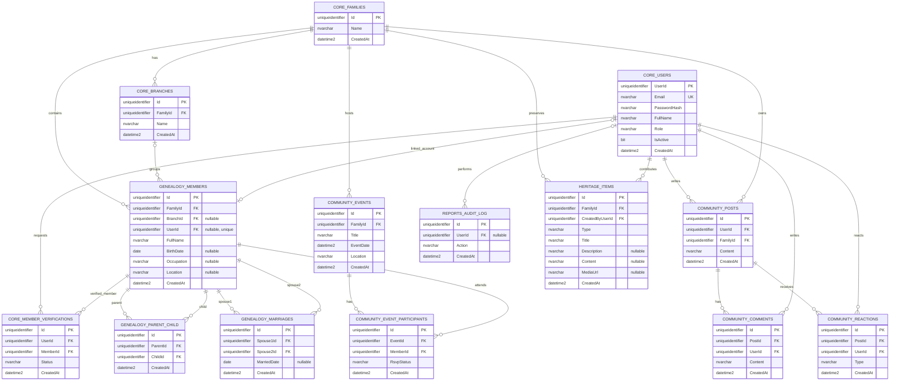

# Sơ đồ ERD FamilyConnect

Đây là sơ đồ thiết kế dữ liệu mà nhóm thống nhất cho FamilyConnect. Các file SQL tương ứng trong `database/schema/` đang để trống để thành viên lần lượt triển khai.

## Quy ước trong thiết kế

- Theo thiết kế, ERD có 14 bảng: `core` có 4, `genealogy` có 3, `community` có 5, `reports` có 1 và `heritage` có 1. Đây là số bảng dự kiến, chưa phải số bảng đã tạo trong database.
- `heritage.Items` lưu tài liệu (`document`), câu chuyện (`story`) hoặc ảnh (`photo`). Cột `Content` dùng cho nội dung văn bản; `MediaUrl` lưu đường dẫn tệp ảnh hoặc tài liệu.
- Theo thiết kế, `genealogy.Marriages` lưu một cặp theo thứ tự `Spouse1Id < Spouse2Id`; backend cần sắp xếp hai UUID trước khi ghi.
- `genealogy.Members.UserId` là tùy chọn và duy nhất khi có giá trị. `core.MemberVerifications.MemberId` tham chiếu thành viên qua FK được thêm ở script cuối.
- Theo thiết kế, xóa bài viết sẽ xóa bình luận và reaction; xóa sự kiện sẽ xóa các RSVP liên quan.

## Nguồn dữ liệu

Khi triển khai SQL, đối chiếu các bảng và quan hệ với sơ đồ này. Xem [hướng dẫn database](../../database/README.md) để biết thứ tự file và cách chạy sau khi nhóm hoàn thành script.
