# Sơ đồ ERD FamilyConnect

Đây là sơ đồ thiết kế dữ liệu mà nhóm thống nhất cho FamilyConnect. ERD đồng bộ với T-SQL hiện có: 22 bảng thuộc 5 schema.

```mermaid
erDiagram
    CORE_USERS {
        uniqueidentifier UserId PK
        nvarchar Email UK
        nvarchar PasswordHash
        nvarchar FullName
        nvarchar Role
        bit IsActive
        datetime2 CreatedAt
    }
    CORE_FAMILIES {
        uniqueidentifier Id PK
        nvarchar Name
        datetime2 CreatedAt
    }
    CORE_BRANCHES {
        uniqueidentifier Id PK
        uniqueidentifier FamilyId FK
        nvarchar Name
        datetime2 CreatedAt
    }
    CORE_MEMBER_VERIFICATIONS {
        uniqueidentifier Id PK
        uniqueidentifier UserId FK
        uniqueidentifier MemberId FK
        nvarchar Status
        datetime2 CreatedAt
    }
    GENEALOGY_MEMBERS {
        uniqueidentifier Id PK
        uniqueidentifier FamilyId FK
        uniqueidentifier BranchId FK "nullable"
        uniqueidentifier UserId FK "nullable, unique"
        nvarchar FullName
        date BirthDate "nullable"
        nvarchar Location "nullable"
        datetime2 CreatedAt
    }
    GENEALOGY_PARENT_CHILD {
        uniqueidentifier Id PK
        uniqueidentifier ParentId FK
        uniqueidentifier ChildId FK
        datetime2 CreatedAt
    }
    GENEALOGY_MARRIAGES {
        uniqueidentifier Id PK
        uniqueidentifier Spouse1Id FK
        uniqueidentifier Spouse2Id FK
        date MarriedDate "nullable"
        datetime2 CreatedAt
    }
    GENEALOGY_EDUCATIONS {
        uniqueidentifier Id PK
        uniqueidentifier MemberId FK
        nvarchar Institution
        nvarchar Degree
        date StartDate
        date EndDate
        datetime2 CreatedAt
    }
    GENEALOGY_WORK_HISTORIES {
        uniqueidentifier Id PK
        uniqueidentifier MemberId FK
        nvarchar Company
        nvarchar Position
        date StartDate
        date EndDate
        datetime2 CreatedAt
    }
    COMMUNITY_POSTS {
        uniqueidentifier Id PK
        uniqueidentifier UserId FK
        uniqueidentifier FamilyId FK
        nvarchar Content
        datetime2 CreatedAt
    }
    COMMUNITY_POST_MEDIA {
        uniqueidentifier Id PK
        uniqueidentifier PostId FK
        nvarchar MediaUrl
        nvarchar MediaType
        datetime2 CreatedAt
    }
    COMMUNITY_COMMENTS {
        uniqueidentifier Id PK
        uniqueidentifier PostId FK
        uniqueidentifier UserId FK
        nvarchar Content
        datetime2 CreatedAt
    }
    COMMUNITY_REACTIONS {
        uniqueidentifier Id PK
        uniqueidentifier PostId FK
        uniqueidentifier UserId FK
        nvarchar Type
        datetime2 CreatedAt
    }
    COMMUNITY_EVENTS {
        uniqueidentifier Id PK
        uniqueidentifier FamilyId FK
        nvarchar Title
        datetime2 EventDate
        nvarchar Location
        datetime2 CreatedAt
    }
    COMMUNITY_EVENT_PARTICIPANTS {
        uniqueidentifier Id PK
        uniqueidentifier EventId FK
        uniqueidentifier MemberId FK
        nvarchar RsvpStatus
        datetime2 CreatedAt
    }
    COMMUNITY_EVENT_REMINDERS {
        uniqueidentifier Id PK
        uniqueidentifier EventId FK
        datetime2 ReminderTime
        nvarchar Status
        datetime2 CreatedAt
    }
    COMMUNITY_EVENT_GALLERIES {
        uniqueidentifier Id PK
        uniqueidentifier EventId FK
        nvarchar MediaUrl
        uniqueidentifier UploadedBy FK
        datetime2 CreatedAt
    }
    COMMUNITY_REPORTED_CONTENTS {
        uniqueidentifier Id PK
        uniqueidentifier TargetId
        nvarchar TargetType
        uniqueidentifier ReportedBy FK
        nvarchar Reason
        nvarchar Status
        datetime2 CreatedAt
    }
    CORE_SYSTEM_CONFIGS {
        varchar ConfigKey PK
        nvarchar_max ConfigValue
        nvarchar Description
        datetime2 UpdatedAt
    }
    HERITAGE_HONORS {
        uniqueidentifier Id PK
        uniqueidentifier MemberId FK
        nvarchar Title
        nvarchar Description
        date DateAwarded
        datetime2 CreatedAt
    }
    REPORTS_AUDIT_LOG {
        uniqueidentifier Id PK
        uniqueidentifier UserId FK "nullable"
        nvarchar Action
        datetime2 CreatedAt
    }
    HERITAGE_ITEMS {
        uniqueidentifier Id PK
        uniqueidentifier FamilyId FK
        uniqueidentifier CreatedByUserId FK
        nvarchar Type
        nvarchar Title
        nvarchar Description "nullable"
        nvarchar Content "nullable"
        nvarchar MediaUrl "nullable"
        datetime2 CreatedAt
    }

    CORE_FAMILIES ||--o{ CORE_BRANCHES : has
    CORE_FAMILIES ||--o{ GENEALOGY_MEMBERS : contains
    CORE_BRANCHES o|--o{ GENEALOGY_MEMBERS : groups
    CORE_USERS o|--o| GENEALOGY_MEMBERS : linked_account
    CORE_USERS ||--o{ CORE_MEMBER_VERIFICATIONS : requests
    GENEALOGY_MEMBERS ||--o{ CORE_MEMBER_VERIFICATIONS : verified_member
    GENEALOGY_MEMBERS ||--o{ GENEALOGY_PARENT_CHILD : parent
    GENEALOGY_MEMBERS ||--o{ GENEALOGY_PARENT_CHILD : child
    GENEALOGY_MEMBERS ||--o{ GENEALOGY_MARRIAGES : spouse1
    GENEALOGY_MEMBERS ||--o{ GENEALOGY_MARRIAGES : spouse2
    GENEALOGY_MEMBERS ||--o{ GENEALOGY_EDUCATIONS : studied
    GENEALOGY_MEMBERS ||--o{ GENEALOGY_WORK_HISTORIES : worked
    CORE_USERS ||--o{ COMMUNITY_POSTS : writes
    CORE_FAMILIES ||--o{ COMMUNITY_POSTS : owns
    COMMUNITY_POSTS ||--o{ COMMUNITY_POST_MEDIA : attaches
    COMMUNITY_POSTS ||--o{ COMMUNITY_COMMENTS : has
    CORE_USERS ||--o{ COMMUNITY_COMMENTS : writes
    COMMUNITY_POSTS ||--o{ COMMUNITY_REACTIONS : receives
    CORE_USERS ||--o{ COMMUNITY_REACTIONS : reacts
    CORE_FAMILIES ||--o{ COMMUNITY_EVENTS : hosts
    COMMUNITY_EVENTS ||--o{ COMMUNITY_EVENT_PARTICIPANTS : has
    COMMUNITY_EVENTS ||--o{ COMMUNITY_EVENT_REMINDERS : schedules
    COMMUNITY_EVENTS ||--o{ COMMUNITY_EVENT_GALLERIES : contains
    CORE_USERS ||--o{ COMMUNITY_EVENT_GALLERIES : uploads
    CORE_USERS ||--o{ COMMUNITY_REPORTED_CONTENTS : reports
    GENEALOGY_MEMBERS ||--o{ HERITAGE_HONORS : receives
    GENEALOGY_MEMBERS ||--o{ COMMUNITY_EVENT_PARTICIPANTS : attends
    CORE_USERS o|--o{ REPORTS_AUDIT_LOG : performs
    CORE_FAMILIES ||--o{ HERITAGE_ITEMS : preserves
    CORE_USERS ||--o{ HERITAGE_ITEMS : contributes
```

## Quy ước trong thiết kế

- Schema hiện có 22 bảng: core 5, genealogy 5, community 9, reports 1 và heritage 2.
- `heritage.Items` lưu tài liệu (`document`), câu chuyện (`story`) hoặc ảnh (`photo`). Cột `Content` dùng cho nội dung văn bản; `MediaUrl` lưu đường dẫn tệp ảnh hoặc tài liệu.
- Theo thiết kế, `genealogy.Marriages` lưu một cặp theo thứ tự `Spouse1Id < Spouse2Id`; backend cần sắp xếp hai UUID trước khi ghi.
- `genealogy.Members.UserId` là tùy chọn và duy nhất khi có giá trị. `core.MemberVerifications.MemberId` tham chiếu thành viên qua FK được thêm ở script cuối.
- Theo thiết kế, xóa bài viết sẽ xóa bình luận và reaction; xóa sự kiện sẽ xóa các RSVP liên quan.

- Members không còn Occupation; nghề nghiệp và học vấn lấy từ WorkHistories và Educations.
- ReportedContents.TargetId là quan hệ đa hình theo TargetType; backend cần xác thực bản ghi đích.
- EventReminders theo dõi lịch ở cấp sự kiện; gửi riêng từng người cần bảng người nhận.
- SystemConfigs chỉ lưu cấu hình nghiệp vụ không nhạy cảm. MemberTreePaths là phương án tối ưu tùy chọn.
## Nguồn dữ liệu

Các script T-SQL hiện tại là nguồn triển khai; đối chiếu bảng và quan hệ với sơ đồ này. Xem [hướng dẫn database](../../database/README.md) để biết thứ tự file và cách chạy sau khi nhóm hoàn thành script.
